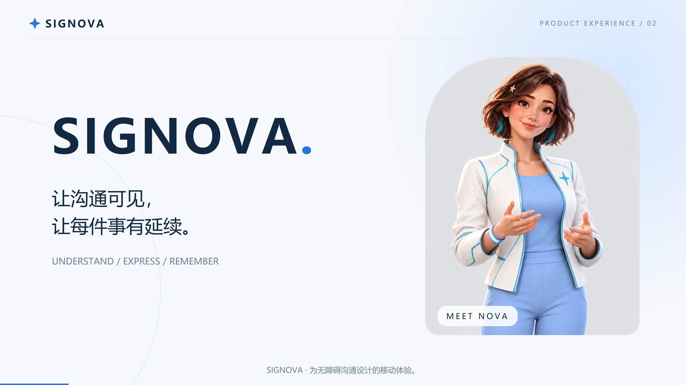
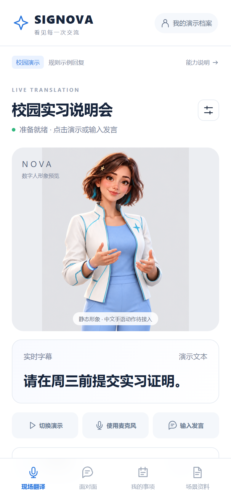
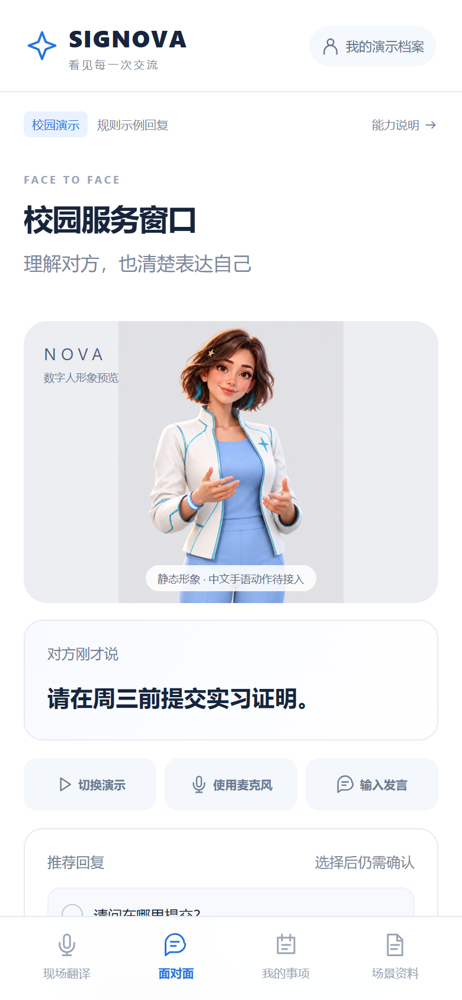
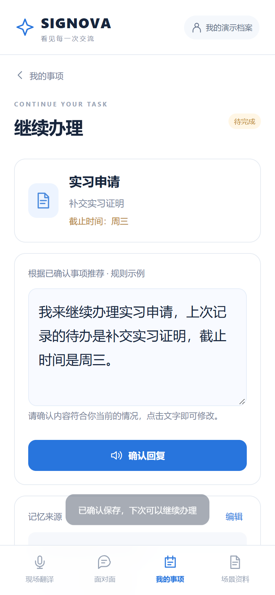
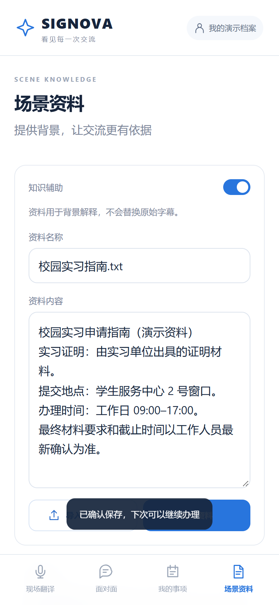

# SIGNOVA
### AI 无障碍沟通与手语翻译

**让沟通可见，让参与平等。**

SIGNOVA 面向聋人及听障用户，围绕现场信息理解、本人表达和跨次事项接续，设计手机端 AI 无障碍沟通体验。通过语音识别、场景知识、手语与字幕、辅助回复及长期事项记忆，让一次交流能够延续到下一次办理。

> 本页介绍产品的最终设计形态，不等同于当前仓库已交付的功能。运行与接入说明见 [开发文档](docs/DEVELOPMENT.md)。

## Agent × Qwen 评测工程

使用同一个 Qwen 模型、同一任务契约和相同可用资料，对比直接调用、旧关键词检索、完整 SIGNOVA Agent，并提供近期对话与本地硬门控的消融。两批共 120 条 AI 辅助构建的合成场景分别在首次调用前冻结，保留逐题原始输出、失败、供应商 Token 用量、文本处理 P50/P95、数据与代码指纹；首轮问题修复后使用新集复测，历史结果不覆盖。

- [评测工程与复现命令](benchmarks/README.md) · [数据集及预设标签](benchmarks/datasets/README.md)
- [最新真实 Qwen 对照](docs/benchmarks/qwen-agent-v2.md) · [首轮与消融](docs/benchmarks/qwen-agent-v1.md) · [vivo / 百度公开研究依据](docs/benchmarks/research-basis.md)
- `npm run bench:qwen:dry` 只检查计划；`npm run bench:qwen` 才调用本机配置的模型；`npm run bench:qwen:report` 离线复算报告。

主指标衡量结构化关联、草稿、更新对象与日期，未评估手语语言质量。报告同时保留改善与退化；公开研究参考与实际跨厂商对测分别说明。

最新 v2 的 60 条冻结合成场景实测（同一 `qwen3.7-plus`，单轮、并发 2）：

| 指标 | 直接 Qwen | SIGNOVA Agent | 变化 |
|---|---:|---:|---:|
| 结构化关联与日期通过 | 42/60（70.0%） | 57/60（95.0%） | 
| 实际输入 Token | 100,921 | 83,351 | 减少 17.4% |
| 实际模型调用 | 60 | 52 | 减少 13.3% |
| 双方通过的 50 题平均文本处理耗时 | 3.886 秒 | 3.289 秒 | 减少 15.4% |

## 产品影片与展示页

跟随一位听障学生办理校园事务，展现 SIGNOVA 面向聋人及听障用户的产品愿景：**看见现场信息 → 自主表达 → 确认并接续事项 → 平等参与生活**。影片与展示页沿用 NOVA 品牌形象，结合实际 App 界面与交互逻辑示意。

每一种表达，都值得被认真回应。

**[▶ 在线播放 60 秒品牌片](https://mortalfrank.github.io/Signova/#film)**（1080p，纯音乐配乐，保留原中文字幕）。点击封面即可在网页播放器观看，支持手机和电脑，无需下载文件或启动项目。[单独字幕文件](docs/showcase/captions.zh-CN.vtt) · [下载 MP4](docs/showcase/promo-music-only.mp4?raw=true) · [制作与素材来源](docs/showcase/LICENSES.md)

- [独立产品展示页](https://mortalfrank.github.io/Signova/) · [本地预览与静态部署说明](docs/showcase/README.md)
- [技术案例：上下文、确认记忆与数字人动作管线](docs/showcase/TECHNICAL_STORY.md)

技术案例对应当前代码中的模型接口、结构化结果校验、用户确认、版本化事项和骨架动作适配，集中说明实现与研究范围。产品展示页通过 GitHub Pages 提供在线访问，也可独立部署到个人网站。

## 默认入口

下载并启动项目后，默认进入 **NOVA IP 图片与校园示例展示**，可切换示例或观看产品影片。真实功能需在首页输入部署者提供的 **体验 Key** 后进入；模型 API Key 不作为体验 Key。

启动与配置见 [体验访问说明](docs/ACCESS.md)。

## 产品体验

| 现场翻译 | 面对面交流 |
| --- | --- |
|  |  |

| 我的事项 | 场景资料 |
| --- | --- |
|  |  |

以上为项目实际页面截图，采用校园示例内容与 NOVA 品牌形象，展示界面与流程，不作为自动手语生成效果的证明。

## 使用场景

学校、公共服务机构、活动主办方和企业可作为部署方，提供音源与场景资料；个人也可从手机发起会话。

| 场景 | 用户需要 | 产品设计 |
| --- | --- | --- |
| 校园通知、说明会、演讲 | 跟上现场内容，理解术语 | 手语与字幕、片段回看、术语解释 |
| 新闻、赛事等单向传播 | 识别人名、专有词和上下文 | 名单、术语表与背景资料辅助理解 |
| 学校、银行和公共服务窗口 | 理解工作人员的话，表达问题 | 翻译、候选回复、自由输入和确认表达 |
| 再次咨询或补交材料 | 接续上次沟通，了解未办事项 | 已确认事项、办理状态、来源与更正历史 |

不同用户可选择字幕、手语或组合展示。中文与中国手语、英文与美国手语 ASL 按独立语言对设计；具体支持范围取决于对应资源与质量验证。

## 核心功能

### 现场理解

接收手机麦克风、兼容外接设备或机构音源，形成实时字幕，并按稳定的语义片段转换为手语表达。用户可调整字幕大小、回看上一句和查看术语说明。

机构提前提供讲稿、业务指南、名单和术语表，辅助专有词识别与指代理解。背景资料用于理解原话，不自动作为讲话者说过的内容。

### 本人表达

结合当前发言、场景资料和相关事项生成候选回复。用户可以选择、修改或自由输入，确认后通过大字或语音向对方表达。

面对面双向交流指“对方语音 → 手语 / 字幕”和“用户选择 / 打字 → 文字 / 语音”。摄像头识别用户手语属于另一项能力，不包含在这条流程定义中。

### 长期事项记忆

从交流中提出候选事项，经本人确认后保存待办材料、截止时间、地点、状态和来源。下次围绕同一事项交流时，检索相关记忆并辅助组织回复。

记忆支持查看、纠正和删除。更正后的信息替代旧版本参与推荐，个人事项与机构知识分别管理。

## 完整使用旅程

以校园实习申请为例：

1. 参加说明会，通过手语与字幕理解材料要求。
2. 前往窗口咨询，选择并确认“请问在哪里提交？”
3. 核对“补交实习证明”等信息，确认保存事项。
4. 截止时间发生变化时，更新同一事项并保留更正来源。
5. 再次办理时，根据已确认事项推荐“我来补交上次缺少的实习证明”，由本人确认后表达。

## NOVA 手语角色

NOVA 是 SIGNOVA 的女性品牌角色，以亲和、清晰的形象呈现手语。界面优先保证面部、双手和上半身可见，便于辨认动作与非手部表达。

角色外观、骨骼绑定、动作资源和手语语言质量分别处理。最终表达需要目标手语使用者或专业人士参与验证；品牌图片、通用手势或角色能够活动，本身不能证明手语准确。素材来源见 [ASSETS.md](ASSETS.md)。

## 技术架构

**现场翻译链路**

音频采集 → 流式语音识别 → 语义分段与结果稳定处理 → 场景知识检索 → 手语表达转换 → 审核动作 / 片段检索 / 动作生成 → NOVA 手语与字幕展示。

**交流与记忆链路**

当前会话＋场景资料＋已确认事项 → 候选回复 → 本人编辑与确认 → 文字 / 语音表达 → 候选事项提取 → 确认保存 → 下次检索。

| 模块 | 设计职责 |
| --- | --- |
| 语音识别 | 可替换 ASR 接口，处理临时结果、稳定文本和断连恢复 |
| 场景知识 | 按机构、会话及版本检索，辅助术语识别和语义理解 |
| 大模型工作流 | 受约束地生成回复、提取事项与建议更新 |
| 手语转换与呈现 | 组织目标手语的动作、面部及身体表达 |
| 事项记忆 | 保存来源、确认记录、状态和更新关系 |
| 手机交互 | 字幕、手语、回复确认、事项管理和会话操作 |

通用大模型和语音识别服务不直接等于手语翻译系统。具体手语模型、动作资源和呈现引擎按目标语言、资源许可与可懂度验证选择。

## 多音源与随身启动

手机麦克风为基础入口，录音豆等可穿戴设备提供可选的收音和实体按键交互。系统按音源适配，不绑定单一厂商 SDK。

开放设备协议后，可设计“按设备按钮 → 准备反馈 → 锁屏通知 → 点击并解锁 → 进入翻译会话”的体验。实时音频、按钮事件与手机后台能力分别验证；蓝牙配对不代表第三方 App 可以读取音频或自动打开页面。

## 质量验证

- 理解准确性：专有词、否定、日期更正和指代是否正确。
- 手语可懂度：目标手语使用者对语义、动作及非手部表达的评价。
- 实时体验：字幕与手语延迟、长句播放积压和回看体验。
- 用户控制：候选回复可编辑，表达与保存均由本人确认。
- 记忆有效性：相关事项可检索，更正、失效与删除信息正确处理。

场景检索、语义分段和记忆筛选的效果通过对照实验评估，不预设准确率或提升百分比。

## 开发与运行

本地启动、环境配置、模型接入、手机录音条件、代码结构及测试方式见 [开发文档](docs/DEVELOPMENT.md)。

## 关于项目

SIGNOVA 是自主团队项目，源于安克黑客松智能录音赛道构思，后续独立推进。团队围绕产品与 AI 工作流、算法和全栈开发协作，不代表安克官方产品或合作项目。
