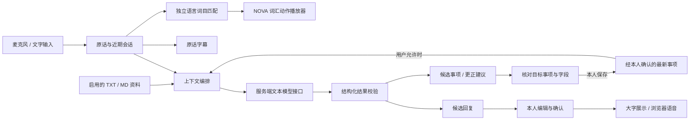

# SIGNOVA：把一次交流延续到下一次

SIGNOVA 的产品目标是帮助聋人及听障用户完成现场理解、自主表达和跨次事项接续。它将字幕、候选回复、用户确认的事项记忆和 NOVA 数字人组织在同一个手机交互中。

这个项目的技术重点是**如何组织现有模型与状态，让每一条建议有上下文，每一次表达和记忆更新有确认步骤**。以下描述对应本地代码与 2026-10-19 的项目记录；产品愿景与当前实现分开呈现。代码链接对应已公开的模块，未带链接的动作组件名称用于说明本地动作工程。

## 为什么从“办一件事”出发

校园窗口中的交流经常包含材料、截止时间、地点及后续步骤。字幕能解决眼前的信息传递，但用户还需要提问、记住重要信息，并在再次办理时接上此前的沟通。

因此 SIGNOVA 围绕一个明确的体验链路设计：

> 看清原话 → 选择或编辑回复 → 本人确认表达 → 核对并保存事项 → 更正时更新同一事项 → 下次继续办理。

这个切入点使交互、模型调用与记忆更新能够在同一个场景内验证，也让“记忆”有可观察的作用：更正后的日期应该出现在下一次表达中，而旧日期只保留在历史记录里。

## 实际系统模块

| 模块 | 当前实现 | 对应代码 |
| --- | --- | --- |
| 手机交互 | 现场字幕、面对面回复、事项列表、继续办理、场景资料 | [`public/app.js`](../../public/app.js) |
| 云端语音入口 | 浏览器采音，转换为单声道 PCM16，经本地后端 WebSocket 转发到配置的识别服务 | [`asr.mjs`](../../asr.mjs)、[`asr-client.js`](../../public/asr-client.js)、[`pcm-worklet.js`](../../public/pcm-worklet.js) |
| 文本模型接口 | OpenAI 兼容 Chat Completions 接口，当前接入千问；生成候选回复、事项草稿与更新建议 | [`model.mjs`](../../model.mjs) |
| 上下文选择 | 当前发言、最近最多 6 条会话发言、启用的资料，以及经额外授权的最多 6 条最新事项 | [`model-context.js`](../../public/model-context.js) |
| 确认记忆 | 同一事项更新当前版本，保留旧版本、来源与更新时间，支持完成和删除 | [`core.js`](../../public/core.js) |
| 动作呈现 | 中国手语与 ASL 独立目录；动作包校验、50 骨骼重定向与 Three.js 播放 | `sign-library.js`、`nova-sign-clip.js`、`nova-sign-avatar.js` |

模型和云端语音需要有效配置，并由用户主动开启。默认规则演示与实际模型结果有不同来源标识；配置字段齐全不等于调用成功。麦克风还依赖权限、浏览器和安全上下文。

## 三个关键设计取舍

### 1. 模型只提出候选，不直接执行

模型输出被限制为候选回复、事项草稿、建议更新的事项标识及确认说明。服务端校验结构、长度及事项引用；前端再由用户决定是否表达、保存或更正。

这样把“模型理解”与“用户操作”分开。比如，识别到“周五提交”不能直接覆盖所有事项，更新建议需要匹配到一件已存在的事项；无法明确指代时应该先询问。

结果校验降低了格式错误和错误事项引用带来的影响，但不保证语义永远正确。用户能检查原话、修改回复、选择更新目标，是工作流中的必要步骤。

### 2. 记忆以事项为单位，并区分当前与历史

当前记录包含事项名称、待办内容、截止时间、状态、来源与更新时间。用户把“周三”更正为“周五”时，新内容成为同一事项的当前版本，旧版本进入历史列表。

在用户允许模型参考记忆时，代码根据本次文本与事项标题、内容的词项重合度筛选，再结合更新时间排序，最多发送 6 条最新事项。历史版本不参与这次模型上下文。

这是一种有明确来源和确认步骤的事项记忆实现。它不是模型持续训练，也不是已经部署的向量数据库。当前数据保存在浏览器 `localStorage`；演示档案切换不等于账户鉴权，不提供跨设备同步。

当前“继续办理”页面的基础回复由已确认字段组成规则模板，可由用户修改；交流页启用模型和记忆权限后，才会把选出的最新事项交给模型生成建议。这两条路径应分别说明。

### 3. 数字人语言与动作工程分层

语音识别和通用文本模型不能直接保证手语语法或动作正确。因此，原话字幕、语言词目匹配、动作来源、骨架适配与播放器分别处理。

NOVA 使用 50 骨骼，双手包含 30 个指节。当前动作管线将来源动作映射到目标骨架，进行腕部位置约束、手掌和指节方向处理及数值连续性检查；播放器支持重播、慢放、定位和放大查看。

中国手语动作来源是 NationalCSL-DP 公开词目视频的本地关键点估计，ASL 动作来源是 StudioGalt 的动捕 FBX。前者具有单目深度与遮挡不确定性；后者仍需要适配和视觉检查。两类来源都不直接等于 NOVA 的最终语言准确性。

当前产品开放中国手语“停止”与 ASL 的 Hello、Please、You 共 4 个待核验词汇预览。它们按语言分开，不能任意拼接后宣称整句翻译。数字人的面部语言通道和完整表达仍是研究方向。

## “资料辅助”与“长期记忆”分别解决什么

- **场景资料**：用户导入或编辑 TXT / MD，启用后用于模型理解背景。当前是有限文本直接进入上下文，默认规则路径仅做有限关键词说明；不是已经部署的多文档向量检索系统。
- **个人事项**：只有经过确认保存的记录，才进入后续记忆选择流程。它描述用户正在办理什么，不代表机构公开知识。
- **原话**：始终单独保留。资料中的内容不自动改写成工作人员说过的话。
- **更正来源**：更新后保留新来源及历史版本，便于回看信息从哪里改变。

这些边界让知识、当前会话和个人事项各有职责，避免把“可能相关的内容”都当作已经确认的事实。

## 验证应覆盖什么

| 验证层 | 检查的问题 | 证据类型 |
| --- | --- | --- |
| 工程与状态 | 数据结构是否有效；是否保留历史；语言目录是否混用；异常能否恢复 | 自动化测试、包校验与源码 |
| 真实接口 | 有效配置下，模型是否实际返回；语音数据能否完成转写 | 实际请求结果、输入输出记录 |
| 交互 | 回复是否由本人确认；更正是否更新正确事项；刷新后能否继续 | 浏览器操作与截图 |
| 手语可理解性 | 目标用户是否理解相同意思；手形、空间位置与非手部表达是否正确 | 手语使用者或专业人士参与的评价 |

前三类证据不能代替第四类。本次局部页面验证记录可见 [交互验证记录](verification/APP_FLOW.md)；不把测试项数写成翻译准确率，不预设延迟、召回率或改善百分比。

### 本次展示链路验证

2026-10-19 12:19（本机）使用虚构校园事项和**文字输入**完成真实千问接口联调：提取“提交实习证明”的候选事项、用户确认保存；输入更正后，模型建议更新原事项的截止时间为周五；本人确认后保存，历史仍保留周三前。刷新页面并重新进入事项，最新日期仍为周五。更正请求期间出现过一次网络失败，重试后成功，因此不将剪辑后的展示时长写成接口延迟。

相关原始界面截图保留在 [verification/app/](verification/app/) 的 `03-model.png`、`04-reply.png`、`08-correct.png`、`10-continue.png` 和 `11-history.png`。这次验证证明该本地环境下的模型与事项更正链路可运行；不构成麦克风实录、跨设备同步、全量输入正确性或手语理解度验收。

## 已有实现与后续方向

已有实现包括手机交互、可配置的模型和语音接口、回复与事项确认、浏览器内的版本化记忆，以及独立的 NOVA 词汇动作管线。

后续重点是：在有限场景内完成经过语言验证的完整表达，改善动作接触和手部拓扑，补充面部语言通道，并通过目标用户测试确认是否真的更容易理解。账号同步、录音设备 SDK 和更大规模知识检索需要各自的工程与验收。

预渲染动作片段可以作为一种候选呈现方式：提前把动作与材质处理好，由运行时进行匹配和播放。它仍需真实语义对应和来源记录，不能用普通角色动画代替手语语言验证。

## 用于面试时如何讲清楚

先从一次具体办理解释用户为什么需要“再次接续”，然后展示一次日期更正及它如何影响当前事项。接着说明三个实现决定：模型产生候选、确认后写入状态、最新事实与历史分离。最后再展开数字人动作数据到目标骨架的工程过程，以及为什么工程数值通过不代表语言正确。

个人贡献应按实际负责的产品设计、代码模块、验证和协作说明，不把整支团队的工作自动写成个人独立完成。本案例没有使用自研基础大模型、完整手语覆盖或跨设备上线作为项目卖点。

## 来源与延伸

- [开发与运行说明](../DEVELOPMENT.md)
- [影片素材与动作来源](LICENSES.md)
- [素材与许可](../../ASSETS.md)
- [NationalCSL-DP v3](https://doi.org/10.6084/m9.figshare.27261843.v3)：Siyuan Jing，CC BY 4.0；NOVA 中的派生动作由本项目本地估计与适配。
- [StudioGalt 动捕归档](https://github.com/StudioGalt/Sign-Language-Mocap-Archive/tree/eb9046596fffcc6e92ee91d021372961f3d4fcaa)：CC0-1.0 FBX，固定版本来源。
- [SIGNOVA GitHub](https://github.com/Mortalfrank/Signova)
